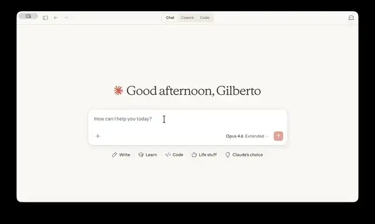

<p align="center">
  
</p>

# cofounder

Um cofundador movido por IA que guia você da ideia ao app publicado na internet, sem precisar saber programar.

[Click here for the English version](README.en.md)



## O que ele faz

O cofounder é um conjunto de [skills](skills/) para o seu agente de programação. Ele conversa com você em linguagem simples, escreve com você a especificação do produto, desenvolve o app, testa e publica na Locaweb Cloud.

Este repositório empacota o cofounder como plugin do **Claude Code** e do **Codex**. Para outros agentes (Cursor, Gemini, OpenCode e outros), instale as skills via `npx skills`, como explicado no [locaweb/cofounder](https://github.com/locaweb/cofounder).

## Instalação

### Claude Code

Dentro do Claude Code, rode:

```
/plugin marketplace add locaweb/cofounder-plugin
/plugin install cofounder@locaweb
```

Para começar, abra o Claude Code na pasta do projeto e rode `/cofounder:iniciar` (ou peça algo como "quero criar um app"). Na primeira vez, o cofounder grava um `AGENTS.md` e um `CLAUDE.md` no projeto: a partir da sessão seguinte, ele inicia sozinho naquela pasta.

Para receber as atualizações automaticamente, ative o auto-update em `/plugin` → **Marketplaces** → **locaweb** → **Enable auto-update**. Para atualizar manualmente, rode `claude plugin update cofounder@locaweb` no terminal.

### Codex

No terminal, adicione o marketplace:

```
codex plugin marketplace add locaweb/cofounder-plugin
```

Depois abra o `codex`, rode `/plugins`, instale o **cofounder** do marketplace **locaweb** e inicie uma nova sessão. Na primeira sessão em cada projeto, peça para usar o cofounder (por exemplo, "quero criar um app com o cofounder"); ele grava um `AGENTS.md` no projeto e, a partir da sessão seguinte, inicia sozinho naquela pasta. Também na primeira sessão, o cofounder pede sua aprovação uma vez para configurar o projeto (`.codex/config.toml` com acesso total, e a pasta marcada como confiável no Codex), para poder instalar ferramentas e rodar comandos sem pedir permissão a cada passo; isso vale a partir da sessão seguinte. Para atualizar, rode `codex plugin marketplace upgrade locaweb`.

### Ferramentas de desenvolvimento

O cofounder usa algumas ferramentas no seu computador (mise, Podman, GitHub CLI e outras). Na primeira sessão, ele confere se estão instaladas e, se faltar alguma, explica como rodar o instalador que vem junto com o plugin.

## Como o cofounder é iniciado

O plugin não roda nada sozinho quando uma sessão começa: o cofounder só age depois que você o chama.

1. **Primeira vez em um projeto:** abra o agente em uma pasta vazia (para um projeto novo) ou em um projeto já criado pelo cofounder e rode `/cofounder:iniciar` no Claude Code. No Codex, peça para usar o cofounder. Em geral, basta pedir algo como "quero criar um app".
2. **Ativação no projeto:** nessa primeira sessão, o cofounder grava um bloco de instruções no `AGENTS.md` do projeto e um `CLAUDE.md` que o importa. Se esses arquivos já existirem, o conteúdo que você escreveu é mantido.
3. **Próximas sessões:** o agente lê esses arquivos ao abrir a pasta e inicia o cofounder sozinho, sem precisar do `/cofounder:iniciar`.

Para desativar em um projeto, apague o bloco entre `<!-- cofounder:begin -->` e `<!-- cofounder:end -->` no `AGENTS.md` e no `CLAUDE.md`.

## Exemplos de uso

- **"Tenho uma ideia de app"**: o cofounder faz perguntas, escreve um PRD e propõe a primeira versão.
- **"Rode o app no meu computador"**: sobe o banco, o backend e o frontend localmente para você testar.
- **"Crie uma página de login" / "corrija este erro"**: implementa a mudança com testes automatizados e confere o resultado visualmente.
- **"Coloque na internet"**: cria o repositório no GitHub e os ambientes de preview e de produção, e publica na Locaweb Cloud.
- **"Use meu próprio domínio"**: configura um domínio personalizado no ambiente de produção.

## Stack

| Camada | Tecnologia |
|--------|------------|
| Backend | Go (`net/http`, `pgx`, `sqlc`) |
| Frontend | React + TypeScript, React Router, Tailwind CSS, shadcn/ui |
| Banco de dados | Postgres (Supabase localmente, via Podman) |
| Testes | testes em Go, Vitest, Playwright |
| Deploy | GitHub Actions → Locaweb Cloud, em um único container |

## Segurança

As skills são **arquivos estáticos instalados localmente**: instruções em Markdown e scripts shell que você pode ler antes de usar. Elas não baixam nem executam código remoto não autorizado. Todo comando roda na sua máquina, pelo seu agente e com a sua permissão. As ferramentas instaladas pelo `install.sh` vêm das fontes oficiais, com versões fixadas e checksums ou chaves de assinatura verificados.

### Verificando uma versão

Cada versão do plugin é publicada como um [GitHub Release](https://github.com/locaweb/cofounder-plugin/releases) com um tarball do plugin e um `SHA256SUMS`. O tarball tem attestation de proveniência que prova que foi gerado pelo workflow `release.yml` deste repositório a partir de um commit específico. Para verificar, use o [GitHub CLI](https://cli.github.com) autenticado:

```bash
VERSION=v0.29.1
gh release download "$VERSION" --repo locaweb/cofounder-plugin --dir "cofounder-plugin-$VERSION"
cd "cofounder-plugin-$VERSION"
sha256sum -c SHA256SUMS   # no macOS: shasum -a 256 -c SHA256SUMS
gh attestation verify "cofounder-plugin-$VERSION.tar.gz" --repo locaweb/cofounder-plugin
```

O `install.sh` e o tarball das skills são publicados, com checksums e attestations próprios, nas [Releases do locaweb/cofounder](https://github.com/locaweb/cofounder/releases); o README de lá explica como verificá-los.

## Desenvolvimento

As skills são desenvolvidas no [locaweb/cofounder](https://github.com/locaweb/cofounder). A pasta `skills/` deste repositório é uma cópia de uma tag de lá, feita pelo workflow `sync-skills.yml`: não edite essa pasta aqui, porque a próxima cópia sobrescreve as mudanças. Aqui ficam só os manifestos do plugin, o comando `/cofounder:iniciar` e os workflows de cópia e de release.

## Suporte

Encontrou um problema ou tem uma sugestão? Abra uma issue no [GitHub Issues](https://github.com/locaweb/cofounder-plugin/issues).

## Termos

- [Política de Privacidade](TODO-privacy-policy-url)
- [Termos de Uso](TODO-terms-of-use-url)
- Licença: Functional Source License (FSL-1.1-ALv2) — veja [LICENSE](LICENSE).
